# Autumn Night Open-Air Bath · 秋夜露天風呂

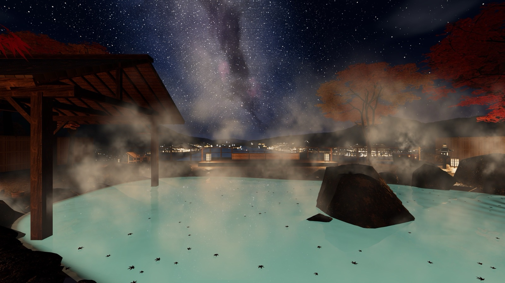

An immersive 3D hot-spring scene you can walk around in. A rock-lined open-air bath sits on a hilltop lookout about 220 m above the sea, surrounded by autumn maples and a traditional bathhouse, and looks out over a ria coastline. Switch between day, dusk and night. After dark the coast lights up and the Milky Way fills the sky.

Plain HTML, CSS and JavaScript with [Three.js](https://threejs.org/). There is no build step.

**▶ Live demo:** https://YOUR-USERNAME.github.io/YOUR-REPO/ *(desktop browser recommended)*

## Screenshots

### Day

| | |
|---|---|
| 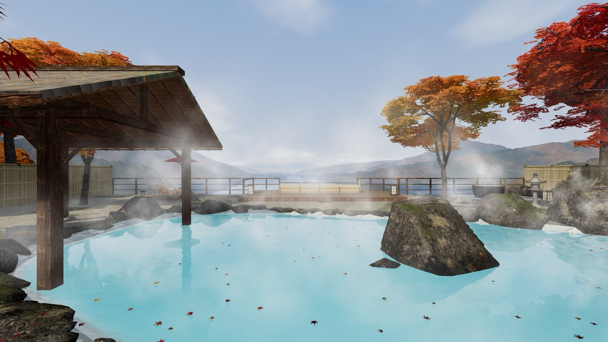 | 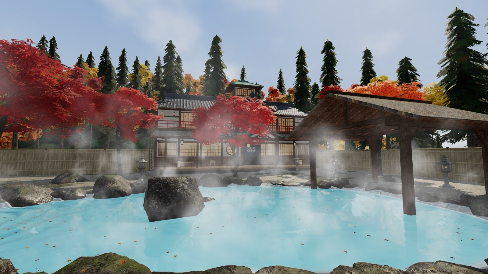 |
| The main pool, with the bay beyond the cliff | The bathhouse, seen from across the pool |
| 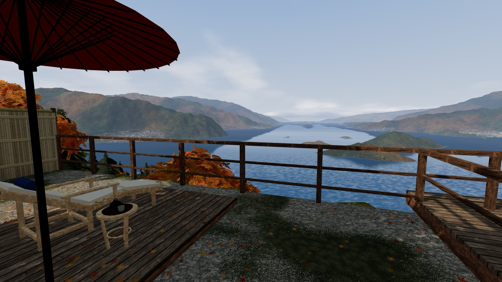 | 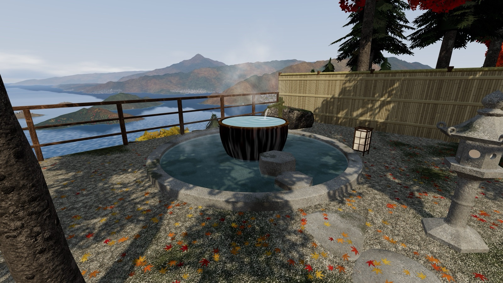 |
| The cliff-edge lookout and the ria coastline | *Tsubo-yu*, a ceramic pot bath |
| 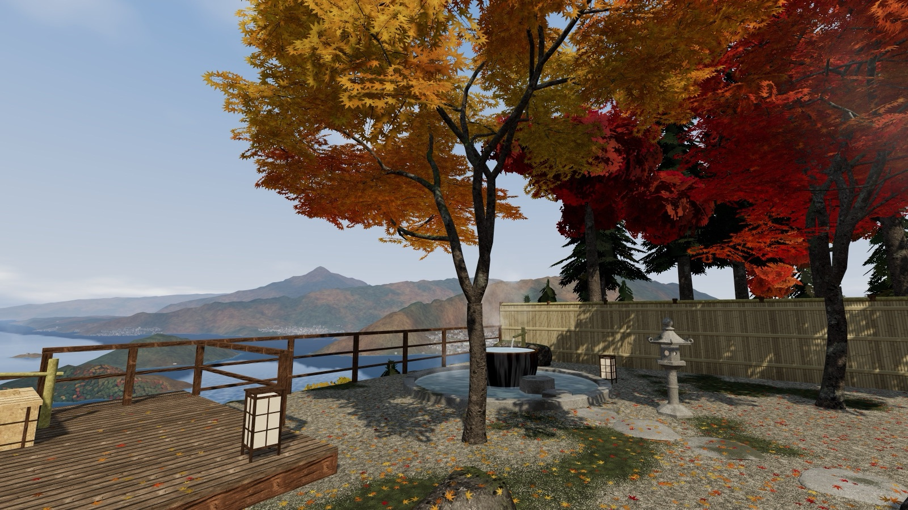 | 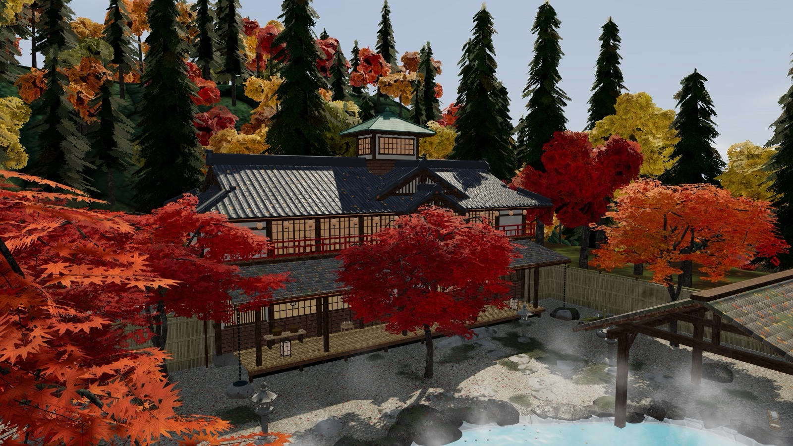 |
| Autumn maples | Viewpoint: the bathhouse from above |

### Dusk

| | |
|---|---|
| 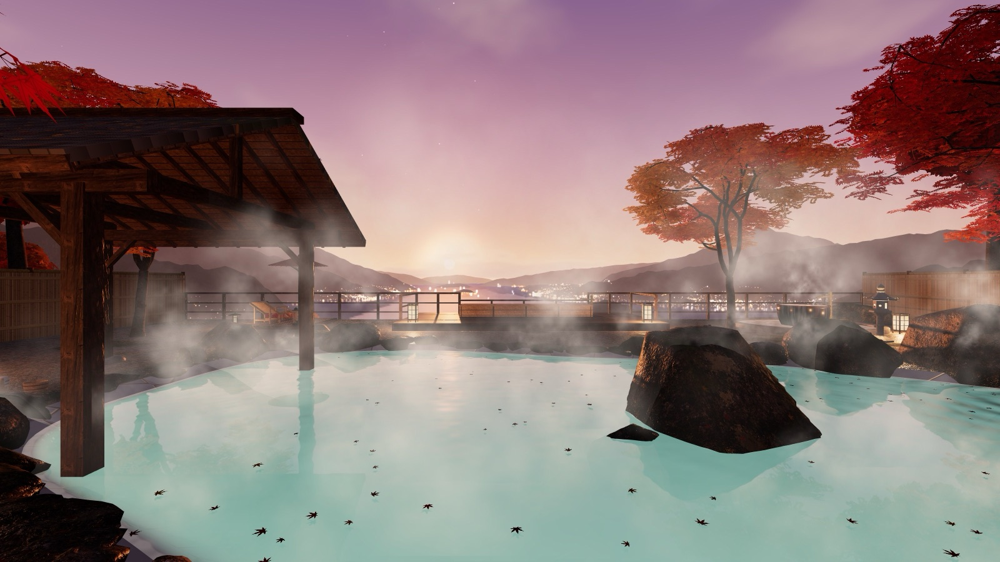 | 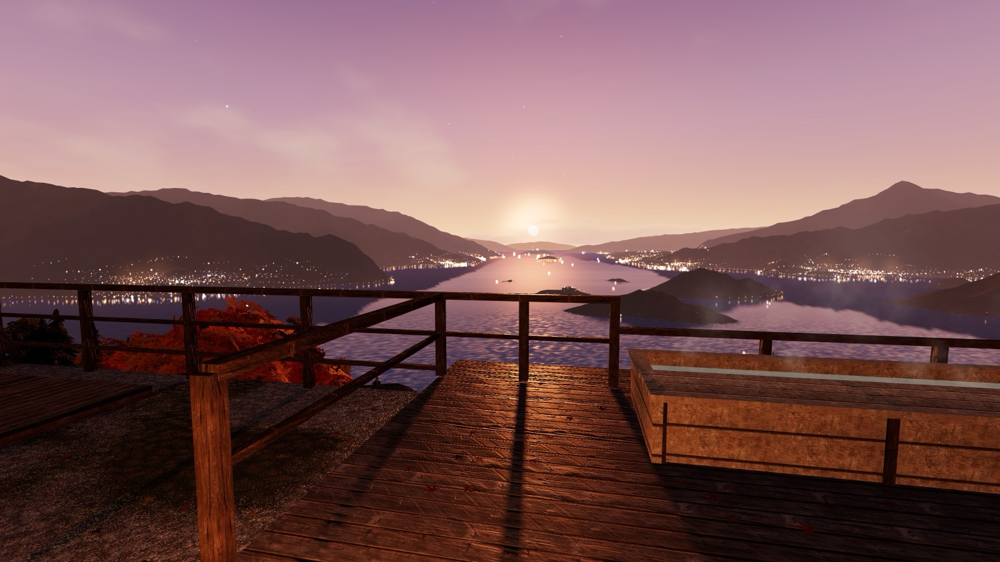 |
| Golden hour over the pool | Sunset from the foot-bath deck |
| 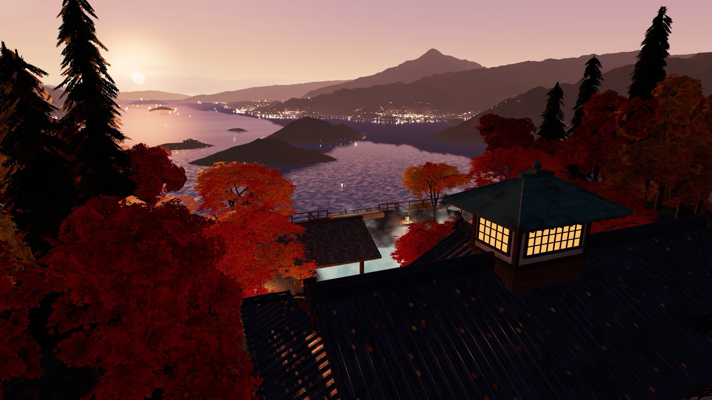 | 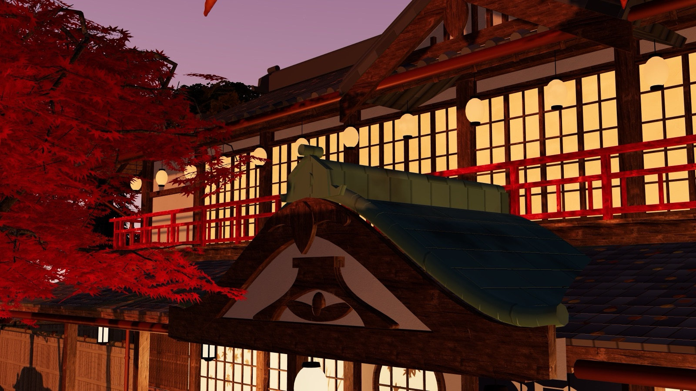 |
| Viewpoint: over the roof toward the bay | Viewpoint: the curved *kara-hafu* gable over the entrance |

### Night

| | |
|---|---|
| 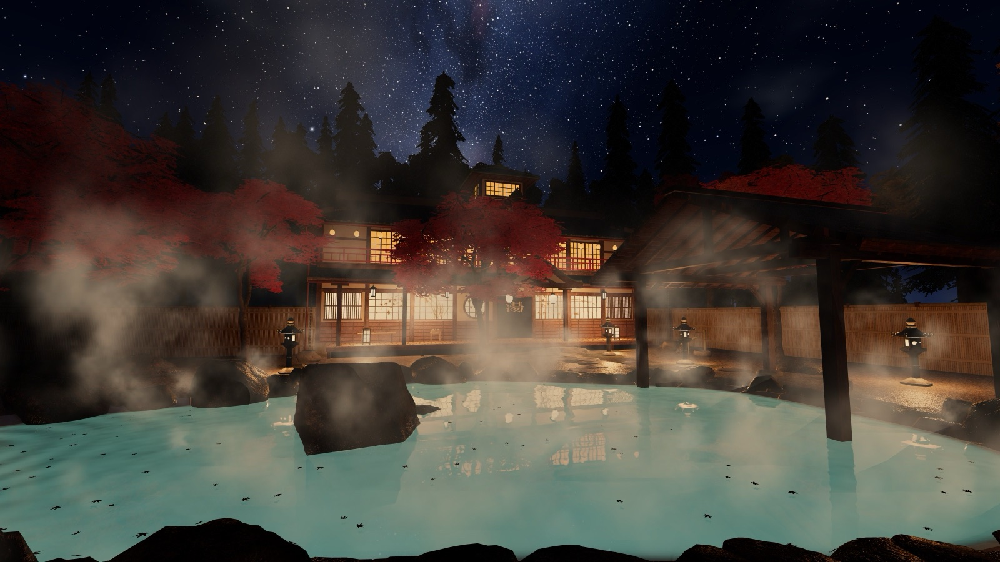 | 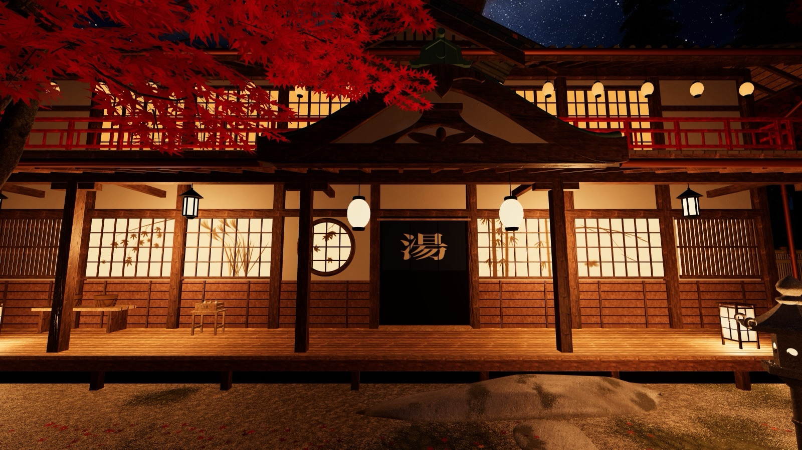 |
| Amber windows across the steaming pool | The entrance, lit by paper lanterns |
| 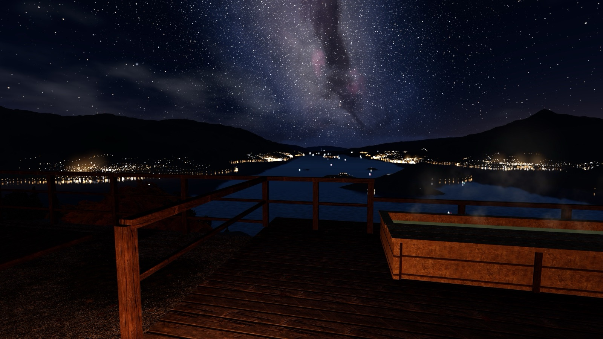 | 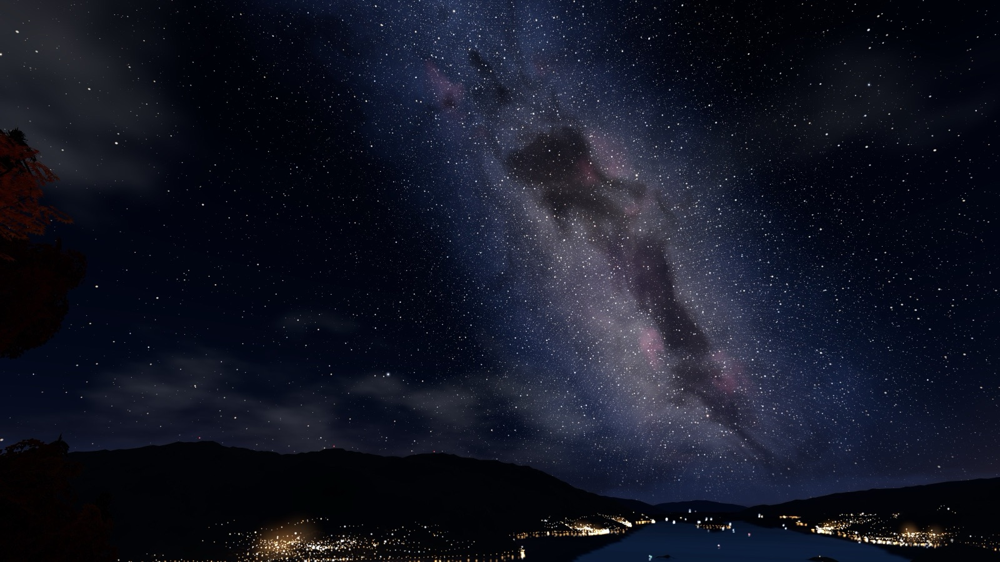 |
| Town lights along the bay | The Milky Way |

## Features

- **Setting:** an open-air rock bath on a clifftop lookout in autumn, with woods and buildings on three sides and a ria bay below to the north. The far landscape is generated: interlocking ridges, islands, open sea and coastal towns.
- **Bathhouse:** a wooden bathhouse with a small lookout tower, vermilion railings, a green copper roof and amber window light, styled after traditional Japanese hot-spring inns.
- **Day / dusk / night:** each change takes about 5 seconds, and you can stay in any of the three. At night the sky has stars, the Milky Way and shooting stars, and the towns along the coast are lit and reflected in the sea.
- **First-person walking** with collision. You can wade into the pool.
- **Interactions** (look at an object and press **E**): soak in the bath, splash water with a wooden bucket, light or put out each lantern (turn them all off and the stars get brighter), sit at the foot bath, soak in the pot bath, lie back on the lounge chair to watch the sky, shake leaves off a low maple branch, and drink bottled milk. The *shishi-odoshi* (bamboo water clacker) cycles on its own.
- **Ambient sound:** running water, birdsong by day and crickets at night, plus footsteps that change with the surface underfoot.
- **Camera views:** fixed viewpoints (**V**) for high angles and telephoto shots, a bird's-eye map (**M**) and area labels (**L**).

The in-scene text (hints, help panel, labels) is in Traditional Chinese.

## Controls

| Key | Action |
|---|---|
| **W A S D** | Move |
| **Mouse** | Look around (click the scene to lock the pointer; you can also drag) |
| **Shift** | Walk faster |
| **E** | Interact with what you are looking at |
| **T** | Cycle day → dusk → night |
| **V** | Next viewpoint (WASD returns to walking) |
| **M** | Bird's-eye view |
| **L** | Area labels |
| **N** | Sound on / off |
| **H** | Help, including a list of everything you can interact with |
| **Esc** | Release the mouse |
| **`** | Developer panel (on a Japanese keyboard: Shift + @) |

## Running locally

ES modules and import maps don't work over `file://`, so serve the folder over HTTP instead of opening `index.html` directly:

```sh
npx serve
# or
python3 -m http.server 8000
```

Then open the printed `localhost` address. Three.js 0.170 is loaded from the jsDelivr CDN, so you need an internet connection.

Use a desktop browser. A recent Chrome on a machine with a decent GPU is recommended; the scene is tuned for image quality, not for mobile.

## Deploying to GitHub Pages

The site is fully static, so no build is needed:

1. Push the repository to GitHub.
2. Go to **Settings → Pages → Build and deployment**, choose **Deploy from a branch**, then select `main` and `/ (root)`.
3. After a minute the site is live at `https://<username>.github.io/<repo>/`. Put that address in the *Live demo* link above.

## Project structure

```
index.html          Page shell, start screen, help panel
css/style.css       UI styles
js/main.js          Setup and main loop
js/layout.js        Floor plan: every position, size, collider and label
js/world.js         Terrain, rocks, bathhouse, pavilion, lookout deck, fences
js/props.js         Lanterns, buckets, shishi-odoshi, milk bottles
js/trees.js         Maples, surrounding forest, fallen leaves
js/water.js         Pool surface with reflections, ripples, spouts, small baths
js/steam.js         Steam particles
js/sky.js           Sky dome, stars, baked Milky Way, shooting stars
js/terrain.js       Height function for the distant landscape (pure math)
js/vista.js         Distant terrain, sea, town lights and their reflections
js/daynight.js      Day / dusk / night transitions and key colours
js/lights.js        Lamps and point lights, switching on and off
js/shaders.js       Surface materials (rock, ground, wood, roof tiles, copper…)
js/interact.js      Gaze detection, hints, interaction animations
js/player.js        First-person movement and collision
js/views.js         Fixed viewpoints (V)
js/labels.js        Area labels (L) and bird's-eye view (M)
js/audio.js         Ambient mix, footsteps, interaction sounds
js/dev.js           Developer panel (lil-gui, loaded on first use)
textures/           PBR textures (CC0)
audio/              Sound recordings (CC0)
tools/              Development scripts (not part of the site)
docs/               Development log (Chinese) and README screenshots
```

### Development tools

The scripts in `tools/` need Node.js. Run `cd tools && npm install` once first. `shot.js` also needs Google Chrome.

- `node tools/shot.js` takes screenshots in headless Chrome. It accepts day, dusk or night and any camera position. The screenshots in this README were taken with it.
- `node tools/perf.js` lists slow frames during startup and day/night changes, and counts compiled shaders.
- `node tools/pano.js` draws the distant skyline and a top-down map straight from `js/terrain.js`, without opening a browser.

## Credits

- [Three.js](https://threejs.org/) r170 (MIT) and [lil-gui](https://lil-gui.georgealways.com/) (MIT), both loaded from CDN.
- Textures from [Poly Haven](https://polyhaven.com/) (CC0). Sources are listed in [`textures/README.md`](textures/README.md).
- Sound recordings from [Freesound](https://freesound.org/) (CC0). Sources and processing are listed in [`audio/README.md`](audio/README.md).

## License

The code is released under the [MIT License](LICENSE). The textures and recordings are CC0, as noted above.
